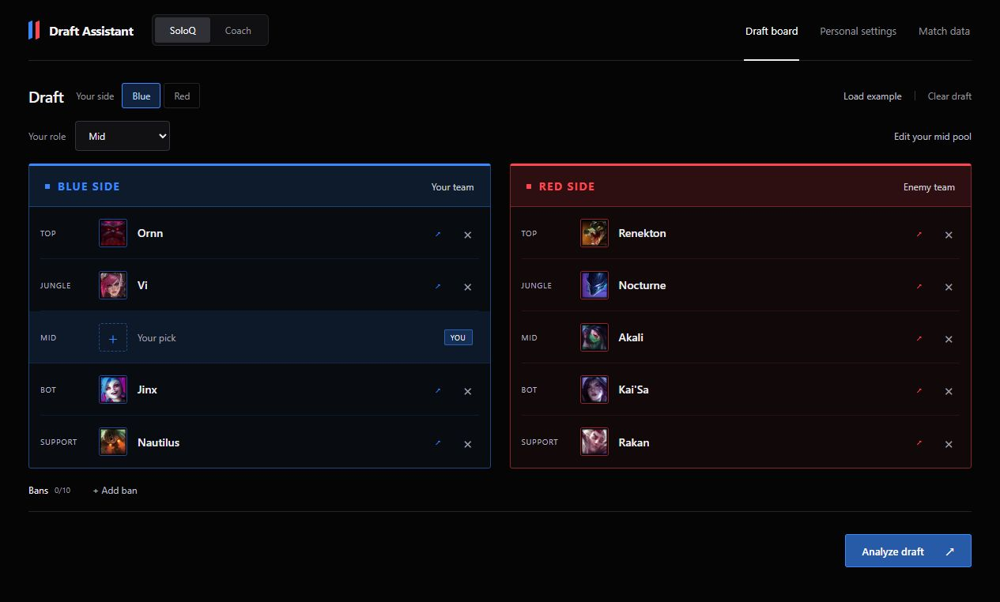
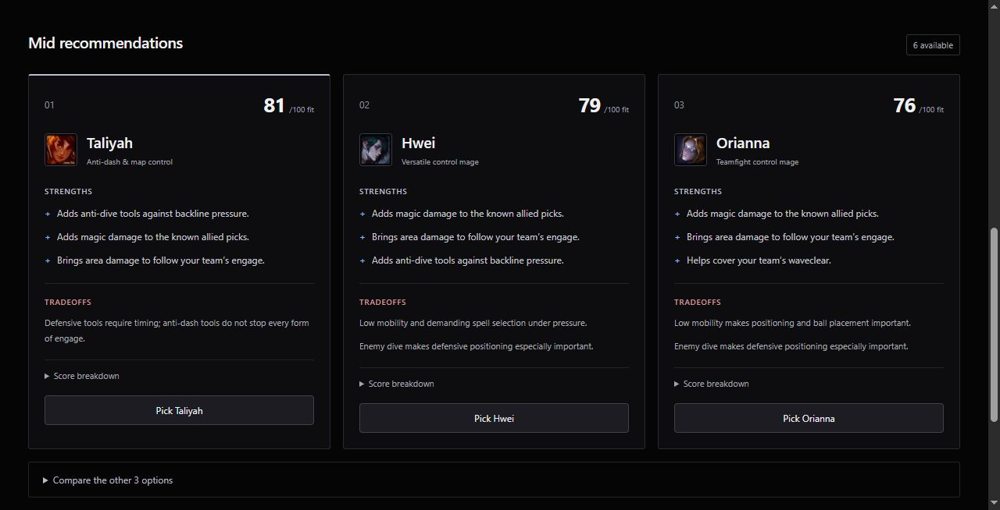
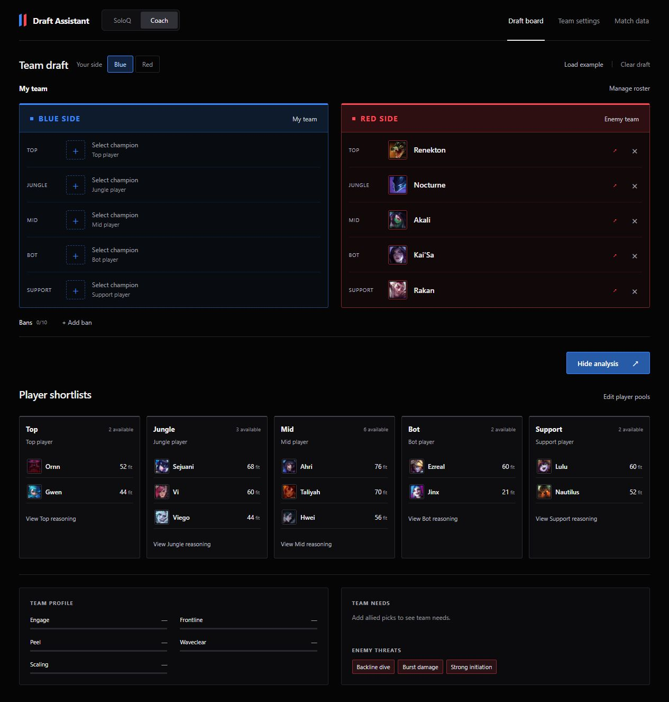
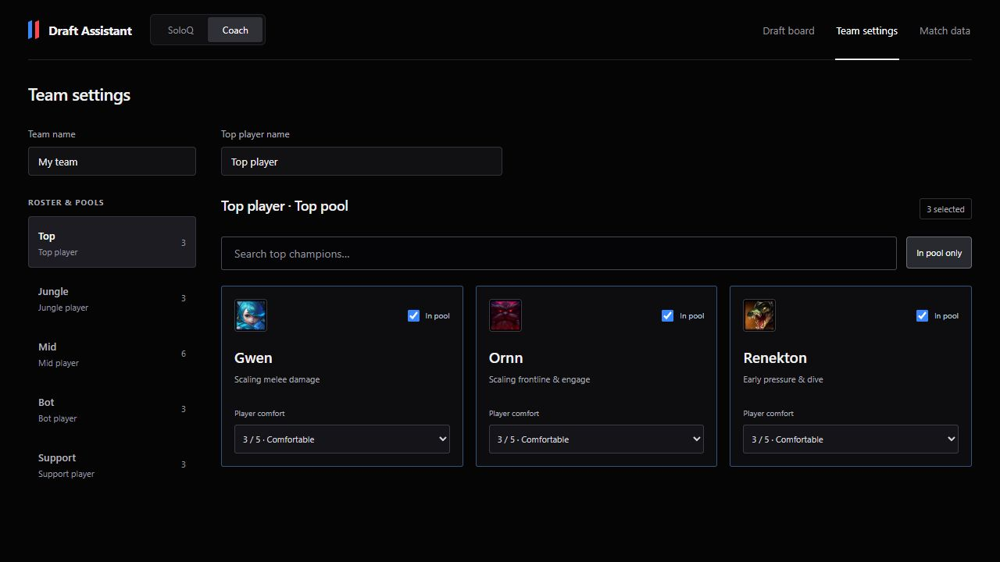

# Draft Assistant

**Early version · Work in progress.** The core features work, but pick suggestions and match-data features are still being developed and refined.

A League of Legends draft planner for individual players and five-player teams. Compare champions from your own pool, see what your team needs, and understand the strengths and weaknesses of each suggested pick.

**React · TypeScript · Vite**



## Features

- **SoloQ and Coach modes:** separate saved drafts for individual and team planning.
- **Champion pools:** choose champions and rate your comfort with them for each role or team member.
- **Pick suggestions:** compare options for each role, with strengths, weaknesses, and score breakdowns.
- **Draft controls:** search champions, add bans, and try a built-in example. Picked or banned champions cannot be selected again.
- **Saved locally:** drafts and settings stay in your browser without an account.
- **Match results:** optionally collect matches and browse them by patch, champion, role, and opponent.

Scores estimate how well a champion fits the draft, **not the chance of winning**. They use editable champion ratings and your comfort settings. Collected match results are shown separately and do not affect suggestions yet.

## Screenshots

<details>
<summary>Recommendations</summary>



</details>

<details>
<summary>Coach mode</summary>



</details>

<details>
<summary>Team settings</summary>



</details>

## Run locally

Requires **Node.js 24** and npm.

```sh
npm ci
npm run dev
```

Open the URL printed by Vite. Use **Load example → Analyze draft** to try it immediately.

Run `npm test` to check the app and match-collection code. Use `npm run build` to create the website files in `dist`.

## Optional match data

The draft planner works without an API key. Collecting matches requires a Riot API key stored in your local `.env` file. The key and collected match files are excluded from Git and are not included in this repository.

See the [match-collection guide](docs/riot-pilot.md) to add match results to your own copy of the app, or the [champion rating guide](src/data/README.md) to adjust the pick suggestions.

---

League of Legends and related game content belong to Riot Games. Draft Assistant is an independent project and is not endorsed by Riot Games.
